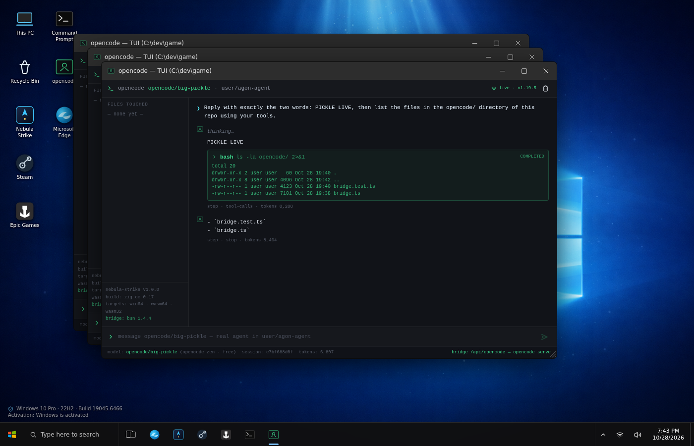

# Nebula OS Shell — web desktop with a real AI agent TUI

A Windows‑10‑style desktop that runs entirely in the browser (React 19 + Vite + Tailwind):
File Explorer, Command Prompt, Edge, Steam/Epic mock‑ups, the **Nebula Strike** game
(a Zig game compiled to **win64 / wasm32 / wasm64**) and an **opencode AI TUI** window
backed by the real [opencode](https://opencode.ai) agent through a Bun bridge.



## Quick start

```bash
npm ci
npm run dev            # http://localhost:5173  (demo mode for the opencode window)

# real AI agent (free model opencode/big-pickle, no API key):
bun install -g opencode-ai
npm run opencode       # Bun bridge :8787 → opencode serve :4096 (vite proxies /api/opencode)
```

Scripts

| script | what |
|---|---|
| `npm run dev` / `build` / `preview` | Vite dev server / production build to `dist/` / preview |
| `npm run lint` | ESLint (0 problems) |
| `npm run opencode` | `bun run opencode/bridge.ts` — real agent bridge |
| `npm run opencode:compile` | `bun build --compile` → single `opencode-bridge` binary (serves `dist/` + API) |
| `npm run test:opencode` | `bun test` — end‑to‑end test of the bridge + real model answer |
| `npm run test:e2e` | Playwright desktop e2e (15 scenarios: windows, terminal, game autotest, opencode demo/live, phone viewport) |
| `node e2e/with-bridge.mjs` | starts the real bridge, runs e2e with the LIVE opencode window, stops it |
| `npm test` / `npm run test:all` | lint + typecheck + e2e (+ bridge test) |
| `npm run opencode:compile:all` | binaries for linux‑x64/arm64, macOS arm64/x64, windows‑x64 → `release/` |

## Cross‑platform

* Runs on **Windows, macOS and Linux**: the bridge finds `opencode` in PATH, `~/.bun/bin`, `node_modules/.bin`,
  `%APPDATA%\npm`, `/opt/homebrew/bin`, wraps `.cmd` shims on Windows and falls back to `bunx opencode-ai`.
* CI (`.github/workflows/ci.yml`) runs lint → typecheck → build → bun bridge test (real model) → Playwright e2e
  on **ubuntu‑latest, windows‑latest and macos‑latest**, then builds single‑file bridge executables for all
  platforms; a `v*` tag publishes them (with `dist/`) as a GitHub Release.
* The desktop works with mouse, touch and pen (pointer events), fits phone screens (windows open maximized
  under 640 px, are clamped to the viewport on resize/rotation) and needs only a modern browser.

## Project layout

```
src/                 desktop shell (App, WindowFrame, Taskbar, StartMenu, apps/*)
src/components/apps/OpencodeApp.tsx   real/demo opencode TUI window
src/lib/agent.ts     scripted "Big Pickle" demo used when the bridge is offline
opencode/bridge.ts   Bun bridge (spawns opencode serve, proxies REST + SSE, serves dist/)
opencode/bridge.test.ts  bun test
opencode.json        opencode config (model opencode/big-pickle, permissions)
game/                Nebula Strike sources (Zig) + build/autotest scripts
public/downloads/    built NebulaStrike.exe, wasm32/wasm64, source zip, autotest results
TEST_REPORT.md       test report (Russian): fixes, benchmarks, opencode integration
```

## In‑desktop tips

* Command Prompt: `help`, `dir`, `nebula`, `opencode` (opens the AI TUI).
* opencode window: green badge **live** = real agent working inside this repository
  (it can read/edit files and run commands there); yellow **demo** = bridge not running.
* Nebula Strike: wasm64 needs Chrome ≥ 133 / Node ≥ 22; wasm32 works everywhere.

See [opencode/README.md](opencode/README.md) for the bridge API and environment variables.
